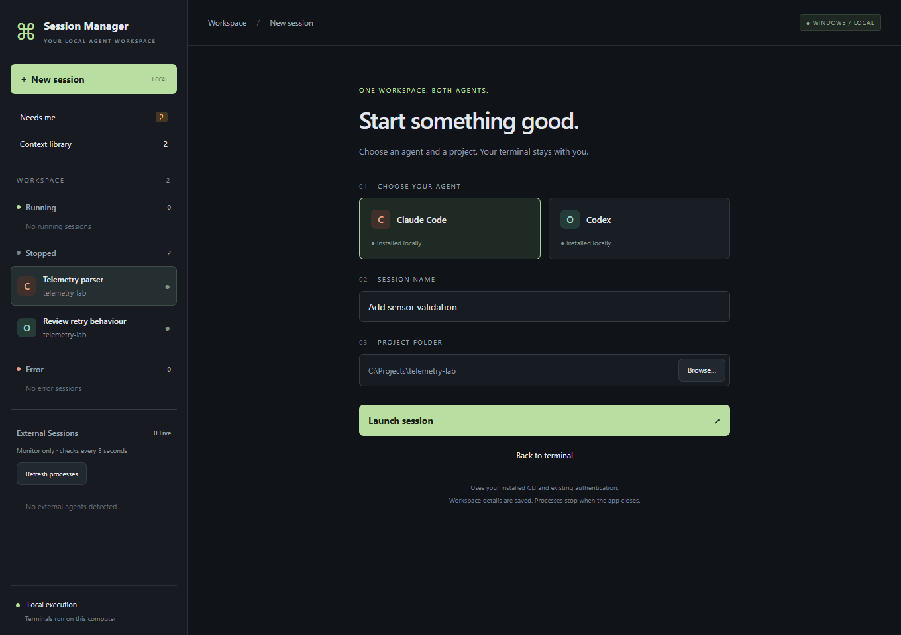
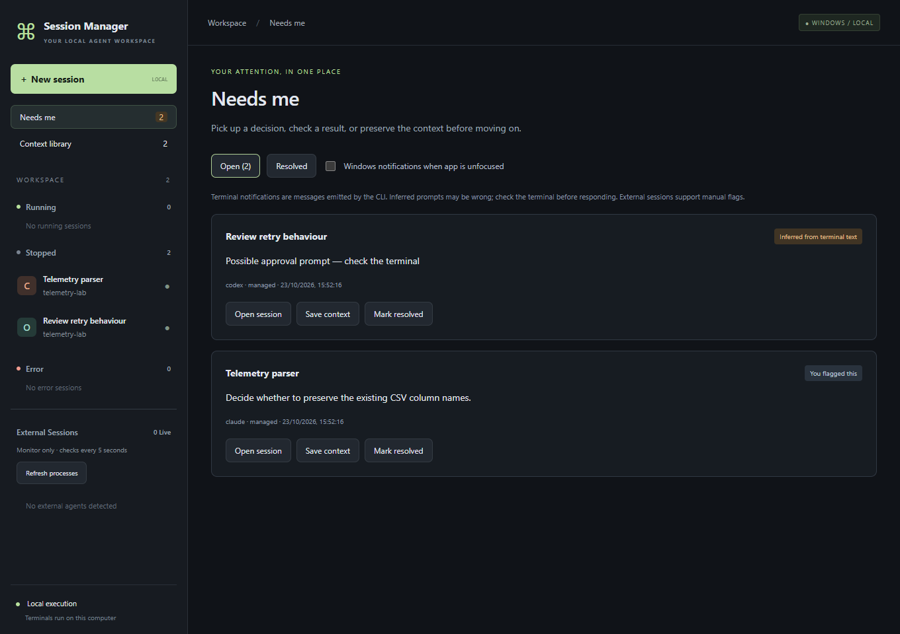
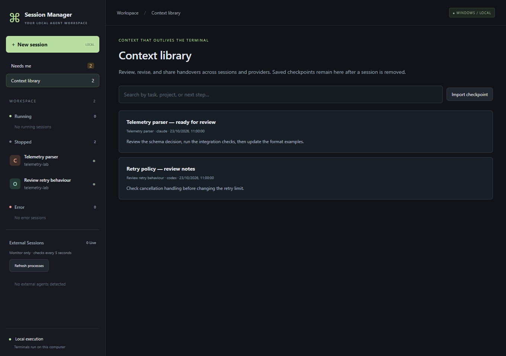
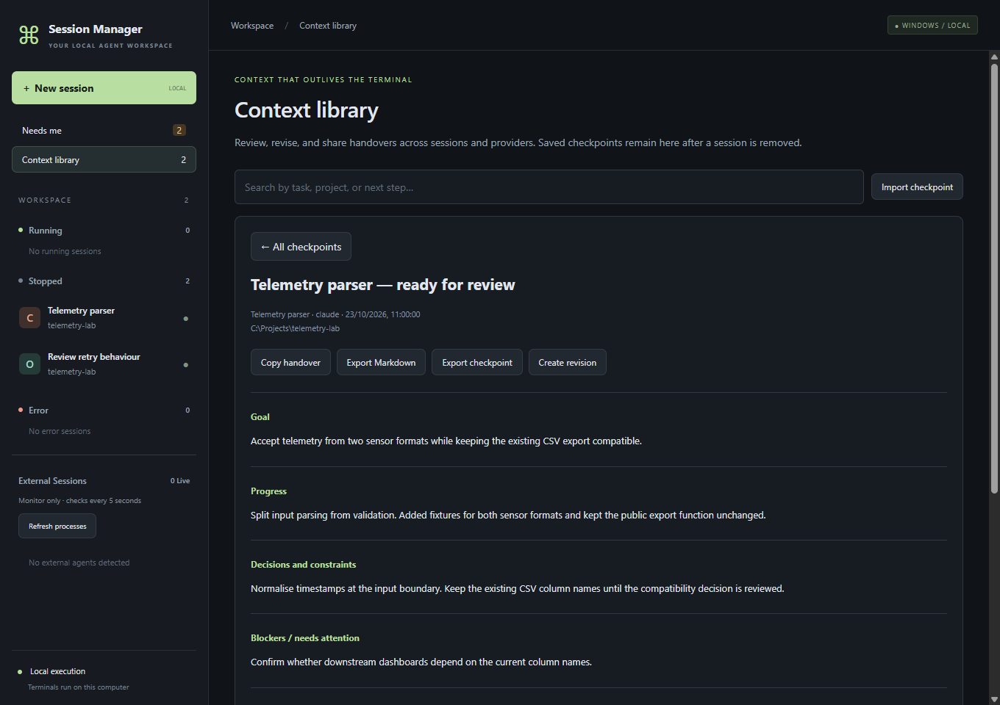

# A look around the app

These are screenshots of the actual Electron app, using fictional project and checkpoint data. The example sessions are stopped; no CLI requests were sent to create these images.

## Starting a session

Choose Claude Code or Codex, give the session a name, and select its project folder. Both providers share the sidebar.



## Seeing what needs attention

The queue keeps reminders and detected prompts together. Each item says whether it was flagged manually, inferred from terminal text, or observed through another supported signal.



## Finding saved context

The library keeps handovers available after their original sessions are removed. Search by task, project, goal, or next step.



## Picking up a handover

A checkpoint records the goal, progress, decisions, blockers, next steps, verification, and references. Copy it into another conversation, export it, or create a revision while keeping the original.



## Updating the screenshots

From the project root on Windows:

```powershell
npm run build
Remove-Item Env:ELECTRON_RUN_AS_NODE -ErrorAction SilentlyContinue
Start-Process .\node_modules\electron\dist\electron.exe -ArgumentList 'scripts/screenshots.cjs','--smoke-test' -WindowStyle Hidden -Wait
```

The capture script opens the real app with a separate temporary user-data directory and example fixtures. It disables external-process discovery for that run, leaves existing workspaces alone, and writes four PNGs to `docs/screenshots/`. It doesn't launch a CLI, send provider prompts, or change the production UI. Locally installed CLI availability still determines the setup screen's installed badges.
